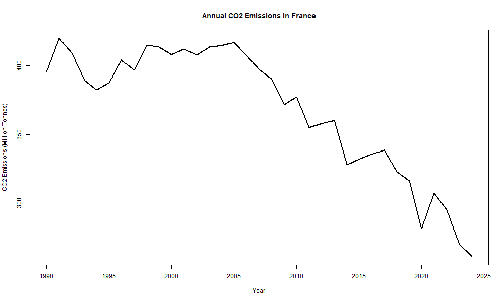
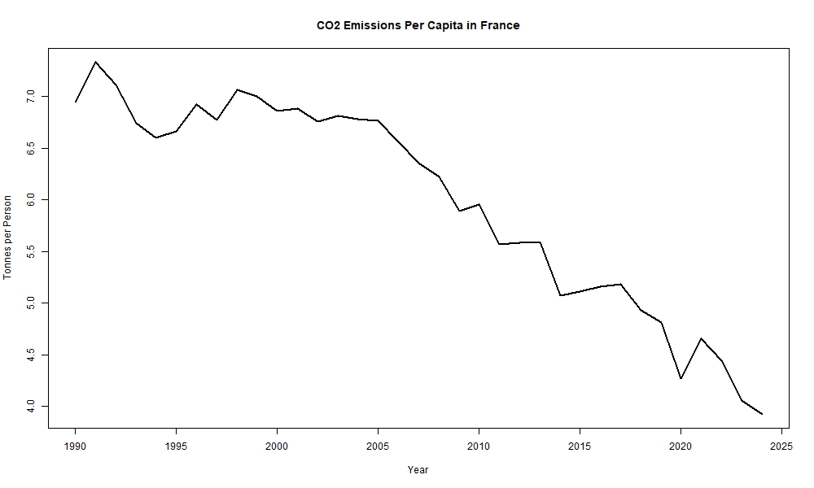
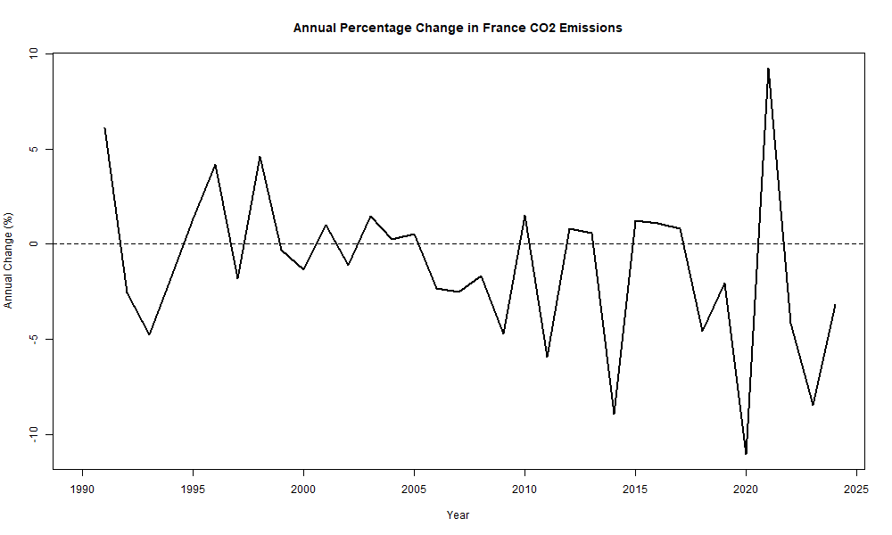

# CO2 Emissions Analysis: France

Student: [Partosa, Alyssa Lou] Country / ISO-3: France / FRA Study period: 1990 to 2024 Declared to instructor on: [Mr. Abner Buco]

## Research Question

How have annual CO2 emissions and per-capita emissions changed in France from 1990 to 2024?

## Data Source and Definitions

Source: Our World in Data (OWID), CO2 and Greenhouse Gas Emissions dataset. Dataset: https://github.com/owid/co2-data Downloaded on: November 14, 2026.

Variables used:

- year: Year of observation.
- co2: Annual fossil-fuel and industrial CO2 emissions, measured in million tonnes (Mt).
- co2_per_capita: Annual CO2 emissions per person, measured in tonnes per person.

The dataset uses territorial accounting. Land-use change emissions are excluded.

## How to Reproduce the Analysis

1. Install R, RStudio, and Git.
2. Open this repository as an RStudio Project.
3. Use an internet connection for the initial dataset download.
4. Run `source("scripts/analyze_co2.R")` in the RStudio Console.
5. Check the `data/`, `figures/`, and `results/` folders.

## Results

- Earliest valid year: 1990 (395.75 Mt CO2).
- Latest valid year: 2024 (261.34 Mt CO2).
- Endpoint percentage change: -33.96%.
- Peak annual emissions: 1991 (419.97 Mt CO2).
- Latest per-capita emissions: 3.93 tonnes/person in 2024.

## Figures

## Interpretation (200-300 words)

France's annual CO2 emissions generally decreased from 1990 to 2024. Emissions declined from 395.75 million tonnes in 1990 to 261.34 million tonnes in 2024, representing an overall decrease of 33.96%. However, emissions reached their highest recorded value in 1991, at 419.97 million tonnes. This indicates that the country's emissions did not decrease continuously throughout the study period.

Per-capita emissions followed a similar downward trend. They increased from 6.94 tonnes per person in 1990 to a peak of 7.33 tonnes in 1991, before declining to 3.93 tonnes per person in 2024. This shows that the decrease occurred in both total national emissions and average emissions per person.

Several noticeable yearly changes were observed. In 2014, annual emissions decreased by approximately 8.92%, while another significant decrease of 11.03% occurred in 2020. Emissions then increased by approximately 9.26% in 2021 before declining again in 2022, 2023, and 2024. These changes are observations from the dataset and do not independently establish their causes. The OECD identifies France's high use of nuclear power as a reason for its relatively low emissions from electricity generation. It also identifies transportation as the country's largest greenhouse gas-emitting sector.

CO2 emissions contribute to climate change, which can affect temperature, rainfall patterns, sea levels, habitats, and biodiversity. Monitoring these trends is important for environmental protection and climate action. Although France's emissions decreased over the study period, continued reductions remain important.

## Limitations

This analysis uses territorial emissions, so emissions from imported products are counted in the country where they are produced rather than where they are consumed. Land-use change emissions are excluded. International aviation and shipping are not assigned to individual countries in this dataset. The analysis also covers CO2 rather than all greenhouse gases. Finally, the graphs show patterns over time but cannot prove that one event or activity caused a particular change.

## References

- Our World in Data. CO2 and Greenhouse Gas Emissions dataset. https://github.com/owid/co2-data
- Our World in Data. CO2 dataset: Sources and methods. https://ourworldindata.org/co2-dataset-sources
- OECD. Environment at a Glance: Country Notes – France. https://www.oecd.org/en/publications/environment-at-a-glance-country-notes_59ce6fe6-en/france_5b08d7f7-en.html